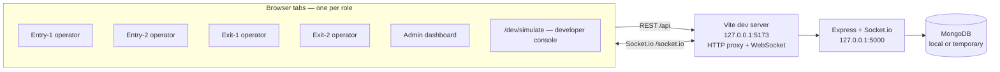
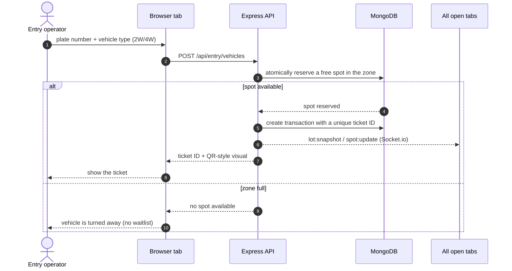
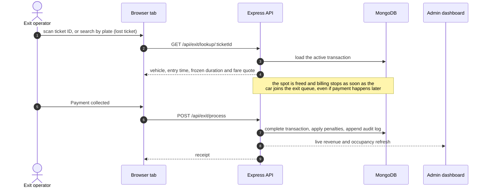
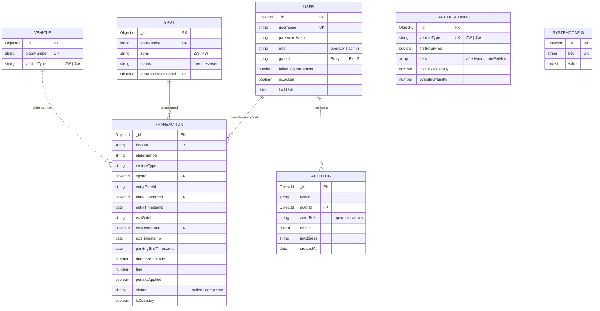

# Vehicle Parking System

A Software Engineering course project (Group 14, Problem Statement No. 10) titled **Vehicle
Parking System**, built on the **MERN stack** (MongoDB, Express, React, Node.js).

**Team:** Siddhesh Dattatray Koditkar (PES2UG24CS502), Sumukh M Gowda (PES2UG24CS537),
Sparsha Arun (PES2UG24CS513), Sinchana Kulkarni (PES2UG24CS504).

A parking lot has multiple entry and exit gates, each staffed by a Gate Operator. A car pulls up,
the operator logs its details, and the system allots it a spot — atomically, so two gates can never
grab the same spot. When the car leaves, the exit operator looks it up by ticket (or plate, with a
lost-ticket penalty) and the system computes an exact, tiered fare. An Admin sees live revenue,
occupancy, the raw database, overstay alerts and the runtime configuration.

There is no hardware, networking or deployment in this project: "multiple gates" and "multiple
terminals" are simulated with **multiple browser tabs on one machine**, each signed in as a
different role, all connected to the same backend over Socket.io.

## Architecture at a glance



Every tab holds its own session (token, role, gate) in `sessionStorage`, so five tabs can be five
different users at once. A change in one tab (spot allotted, overstay flagged, payment collected)
is broadcast to all others.

## Prerequisites

| Software                                                           | Required? | Why                                                                                                                                                                                    |
| ------------------------------------------------------------------ | --------- | -------------------------------------------------------------------------------------------------------------------------------------------------------------------------------------- |
| [Node.js](https://nodejs.org/en/download) **24 LTS** (bundled npm) | **Yes**   | Runs the API, the frontend tooling and the launcher. Version 20.19+ or 22.12+ also works.                                                                                              |
| [MongoDB](https://www.mongodb.com/try/download/community) 8.x      | **No**    | The launcher starts a temporary MongoDB automatically if none is running (unless you configured a `MONGO_URI` that does not answer). Install it if you want data to survive a restart. |
| [Git](https://git-scm.com/downloads)                               | To clone  | Or download the repository ZIP instead.                                                                                                                                                |
| A current browser                                                  | **Yes**   | Chrome, Firefox, Edge or Safari.                                                                                                                                                       |

You do **not** need to install any test tooling, database GUI, or Linux shell to run the app.

<details>
<summary>Install commands per OS</summary>

**Windows** (PowerShell or Command Prompt)

```powershell
winget install OpenJS.NodeJS.LTS
winget install Git.Git
# Optional: winget install MongoDB.Server   (then: net start MongoDB)
```

**macOS**

```bash
brew install node git
# Homebrew's `node` is the latest release; 22.12+ is supported. For the LTS line:
# nvm install 24 && nvm use 24
# Optional: brew tap mongodb/brew && brew install mongodb-community && brew services start mongodb-community
```

**Linux**

```bash
# Recommended: nvm (https://github.com/nvm-sh/nvm#installing-and-updating), so you
# are not stuck on an old distro package
nvm install 24 && nvm use 24

# Or use your distro's Node.js package, but verify: node -v must be 20.19+
# Debian/Ubuntu: sudo apt install nodejs npm
# Fedora:        sudo dnf install nodejs npm
# Arch:          sudo pacman -S nodejs npm
# Optional:      install MongoDB from https://www.mongodb.com/docs/manual/administration/install-on-linux/
```

</details>

`nvm` and `fnm` users can simply run `nvm use` (or `fnm use`) in the repository — `.nvmrc` pins Node 24.

## Quick start

```bash
git clone https://github.com/Siddhesh249/Vehicle-Parking-System.git
cd Vehicle-Parking-System
npm start
```

That is the whole setup. `npm start` (which runs `node scripts/run.mjs`) works identically on
Windows, macOS and Linux, and it:

1. verifies your Node.js and npm versions and tells you exactly how to fix them if they are wrong;
2. installs the root, `server/` and `client/` dependencies with `npm ci` — only when
   something changed (lockfile, Node.js version, platform, or a missing package);
3. creates `server/.env` (with a generated JWT secret) if you do not have one, and never overwrites it;
4. connects to your local MongoDB if it is reachable, otherwise starts a **temporary MongoDB**
   for this run;
5. picks free ports if 5000 or 5173 are already taken, and tells you which ports it used;
6. seeds a clean demo state: five accounts, 6 two-wheeler and 10 four-wheeler spots, an active
   demo fleet, a week of revenue history and audit logs;
7. starts the API and the frontend, waits until both answer health checks, then opens the app and
   the Simulation Console in your browser;
8. stops both services (and the temporary database) when you press **Ctrl+C** — no orphaned processes.

```text
  App         http://127.0.0.1:5173
  Scenario    http://127.0.0.1:5173/dev/simulate
  API         http://127.0.0.1:5000/api/health
  Database    local MongoDB at mongodb://127.0.0.1:27017/vehicle_parking
  Accounts    entry1, entry2, exit1, exit2, admin (password: password123)
```

Sign in with one of the demo accounts (the buttons on the login page pre-fill them; the credentials
still go through the normal bcrypt + JWT login):

| Account | Role          | Gate    | Password      |
| ------- | ------------- | ------- | ------------- |
| entry1  | Gate operator | Entry-1 | `password123` |
| entry2  | Gate operator | Entry-2 | `password123` |
| exit1   | Gate operator | Exit-1  | `password123` |
| exit2   | Gate operator | Exit-2  | `password123` |
| admin   | Admin         | —       | `password123` |

Open five tabs (two entry, two exit, one admin) plus the Simulation Console for the full demo.
Each tab keeps its own session, so you never sign in five times.

### Notes on the first run

- If no MongoDB is running, the launcher downloads a MongoDB binary (~100 MB) to
  `~/.cache/mongodb-binaries` the first time. That database is temporary: its data is discarded
  when you stop the app. Install MongoDB (or set `MONGO_URI`) if you want data to persist.
- Ports may change automatically. The launcher always prints the URLs it is actually using.
- `npm start` starts from a **clean demo state**: parked cars, revenue and overstay flags are not
  carried over from a previous session. Use `npm start -- --keep-data` to keep them.

Useful launcher options (full list: `npm start -- --help`):

| Option                               | Effect                                                 |
| ------------------------------------ | ------------------------------------------------------ |
| `--memory-db`                        | Always use a temporary MongoDB, ignoring any local one |
| `--mongo=local`                      | Require the configured MongoDB                         |
| `--port 5001` / `--client-port 5174` | Preferred ports (the next free one is used if busy)    |
| `--keep-data`                        | Keep the existing demo data instead of reseeding clean |
| `--no-seed`                          | Do not seed at all                                     |
| `--no-browser`                       | Do not open browser tabs                               |
| `--no-install`                       | Fail instead of installing missing dependencies        |
| `--install`                          | Force a fresh `npm ci` of all three packages           |
| `--verbose`                          | Stream the API and frontend logs to the terminal       |

## Manual run (without the launcher)

Everything below is cross-platform and uses only npm scripts. It expects a **running MongoDB**:
the launcher is what starts a temporary one.

```bash
# 1. Install dependencies once
npm ci
npm ci --prefix server
npm ci --prefix client

# 2. Optional local settings. The launcher normally creates this for you.
cp server/.env.example server/.env        # Windows: copy server\.env.example server\.env

# 3. Seed accounts, spots and demo data
npm --prefix server run seed

# 4. Terminal 1 — API on http://127.0.0.1:5000
npm --prefix server run dev

# 5. Terminal 2 — create client/.env containing: VITE_API_MODE=real
npm --prefix client run dev
```

Open **http://127.0.0.1:5173** and the Simulation Console at
**http://127.0.0.1:5173/dev/simulate**. The Vite dev server proxies `/api` and `/socket.io` to
port 5000, so the browser only talks to one origin.

The client alone can also run without a backend in mock mode (`VITE_API_MODE=mock`), which is handy
for UI work. See `client/README.md` and `server/README.md` for the package-level details.

## How it works

### Roles — two, plus one non-role

- **Gate Operator** — four fixed accounts, each scoped server-side to exactly one gate (Entry-1,
  Entry-2, Exit-1, Exit-2). They handle entry/exit for their gate and cannot see history, analytics
  or other gates.
- **Admin / Manager** — live occupancy, revenue and occupancy analytics, overstay alerts with
  force-release, fare/spot/overstay configuration, the full transaction and audit log, and a raw
  database browser.
- **Simulation Console** — not a role. It is a developer tool at `/dev/simulate`, absent from the
  role navigation, compiled out of production builds, and its routes return 404 when
  `NODE_ENV=production` or `DISABLE_SIMULATION=true`.

### Entry flow



Simultaneous requests from multiple gates are served first-come-first-served by server-received
timestamp, and the database enforces one active transaction per plate as well as one transaction
per spot.

### Exit flow, billing and overstay



- The **first hour is free**; after that, hourly rates increase every few hours, with independent
  rate tables for two-wheelers and four-wheelers. Fares are prorated exactly — no rounding.
- A **lost ticket** (plate lookup instead of a ticket scan) adds the configured penalty.
- The **demo clock** compresses time: 5 real seconds = 1 simulated parking hour
  (`SIMULATED_HOUR_SECONDS`). A 26-second stay is displayed and billed as 5.2 hours.
- A vehicle is flagged **overstayed** after the Admin-configured threshold (default 24 simulated
  hours = 2 real minutes). Overstayed spots blink red; an exit operator can notify the Admin from
  the lot map or a lookup, and only the Admin can force-release the spot, which also applies the
  overstay penalty.
- The Admin can edit fare tiers, the first-hour policy, penalties, spot counts and the overstay
  threshold at runtime; changes apply to subsequent exits without a restart.
- Audit log entries are append-only and are rejected by the model if anything tries to update or
  delete them.

### Simulation Console (developer-only)

`/dev/simulate` spawns a fleet of demo cars at a configurable rate. Cars queue at the entry gates
and become real allocations only when the entry operator presses **Generate ticket**. When a car's
intended stay ends it frees its spot, moves to an exit gate and freezes its bill; the exit operator
scans the ticket (or handles a lost ticket), sees the quote, and collects payment. It can also
change traffic while running and apply temporary fare overrides. Its k6 load-test companion is
`loadtest/entry-concurrency.js`.

## Data model



`Transaction` has two important indexes: a normal `{plateNumber, status}` index, and a **partial
unique** index on `plateNumber` for `status: "active"` so a vehicle can have history but only one
active parking session. `Spot` is indexed by `{zone, status}` for allocation.

## Configuration

| Variable                                          | Where                        | Default                                   | Purpose                                                                                                           |
| ------------------------------------------------- | ---------------------------- | ----------------------------------------- | ----------------------------------------------------------------------------------------------------------------- |
| `MONGO_URI`                                       | `server/.env`                | local, unauthenticated                    | MongoDB connection string. When set it is authoritative: the launcher will not silently swap in another database. |
| `MONGO_HOST` / `MONGO_PORT` / `MONGO_DB`          | `server/.env`                | `127.0.0.1` / `27017` / `vehicle_parking` | Used to build the URI when `MONGO_URI` is unset.                                                                  |
| `MONGO_USER` / `MONGO_PASSWORD` / `MONGO_AUTH_DB` | `server/.env`                | unset                                     | Only for a MongoDB that requires authentication.                                                                  |
| `JWT_SECRET`                                      | `server/.env`                | dev fallback                              | JWT signing secret; required when `NODE_ENV=production`. `npm start` generates one when it creates the file.      |
| `PORT` / `CLIENT_PORT`                            | environment or `server/.env` | `5000` / `5173`                           | Preferred ports. The launcher moves to the next free port when one is busy.                                       |
| `APP_HOST`                                        | environment                  | `127.0.0.1`                               | Frontend bind address.                                                                                            |
| `SIMULATED_HOUR_SECONDS`                          | environment                  | `5`                                       | Real seconds that equal one billed hour.                                                                          |
| `OVERSTAY_SCAN_INTERVAL_MS`                       | environment                  | `5000`                                    | Background overstay scan interval.                                                                                |
| `DISABLE_SIMULATION`                              | environment                  | `false`                                   | `true` makes the developer simulation routes return 404.                                                          |
| `SEED_DEMO_DATA`                                  | environment                  | `true`                                    | `false` seeds only accounts and spots.                                                                            |
| `SEED_RESET_DEMO`                                 | environment                  | `true` via `npm start`                    | Wipe operational data and rebuild a clean demo lot.                                                               |
| `SEED_PASSWORD`                                   | environment                  | `password123`                             | Password for all seeded demo accounts.                                                                            |
| `VITE_API_MODE`                                   | `client/.env`                | `mock`                                    | `real` talks to the backend. `npm start` sets it automatically.                                                   |
| `VITE_DEMO_PASSWORD`                              | client env                   | `password123`                             | Password used by the one-click demo buttons.                                                                      |
| `VPS_MONGO_MODE`                                  | environment                  | `auto`                                    | `auto`, `local` or `memory` — same as `--mongo`.                                                                  |
| `NO_BROWSER`                                      | environment                  | unset                                     | `1` prevents `npm start` from opening tabs.                                                                       |

Never commit `.env` files or real credentials; both are git-ignored.

## Project structure

```text
.
├── scripts/            # cross-platform launcher, check suite and doctor
│   ├── run.mjs         # npm start
│   ├── check.mjs       # npm run check
│   ├── doctor.mjs      # npm run doctor
│   └── lib/            # runtime, dependency, MongoDB, port and UI helpers
├── client/             # React + Vite frontend (consoles, admin dashboard, simulation console)
├── server/             # Express + Mongoose + Socket.io API, seed script, Jest tests
├── loadtest/           # k6 concurrent-allocation scenario
├── DOCS/               # SRS, SAD, STP, sprint plan, git workflow, test execution summary
│   └── editable formats/  # ODT sources, PDF build script and document notes
└── package.json        # root scripts: start, check, doctor, test, format
```

## Troubleshooting

Start with the environment report:

```bash
npm run doctor
```

It checks Node.js, npm, dependencies, `server/.env`, MongoDB, ports and the browser opener, and
prints the exact fix for anything that is wrong.

| Symptom                                              | Cause and fix                                                                                                                                      |
| ---------------------------------------------------- | -------------------------------------------------------------------------------------------------------------------------------------------------- |
| `'npm' is not recognized` / `npm: command not found` | Node.js is missing or not on `PATH`. Install Node 24 LTS and reopen the terminal.                                                                  |
| `Node.js … is too old`                               | Use Node 20.19+, 22.12+, or 24 LTS. With nvm: `nvm install 24 && nvm use 24`.                                                                      |
| `Port 5000 … already in use`                         | The launcher picks the next free port automatically. To use a fixed one: `npm start -- --port 5001`.                                               |
| On macOS the app starts on port 5001 instead of 5000 | macOS AirPlay Receiver owns port 5000. Disable it under System Settings → General → AirDrop & Handoff, or keep the automatic port.                 |
| `Could not start the temporary MongoDB`              | The first download needs internet. Install MongoDB, set `MONGO_URI`, or retry online. Alpine/musl Linux is not supported by the official binaries. |
| `MongoDB is not reachable … MONGO_URI is set`        | A configured URI is never silently bypassed. Fix it, remove it, or run `npm start -- --memory-db`.                                                 |
| Data is missing after a restart                      | You are using the temporary database. Install MongoDB or set `MONGO_URI` for persistence.                                                          |
| `npm ci` fails with `EUSAGE`                         | `package-lock.json` is out of sync. Run `npm install` in the affected package, review the diff, and commit the lockfile.                           |
| `EACCES` / `EPERM` during install                    | Fix the folder ownership. Do not run the project with `sudo`.                                                                                      |
| `EBADENGINE` during install                          | Wrong Node.js version. Check `node -v` against the prerequisites above.                                                                            |
| Browser does not open                                | The launcher always prints the URLs. Some headless Linux sessions have no opener; open them manually.                                              |

## Testing

```bash
npm run check     # formatting, server Jest, client Jest, lint, production build, k6 if installed
npm run doctor    # environment report
```

`npm run check` runs every check in order and stops at the first failure. Every step can be
selected or skipped, for example:

```bash
npm run check -- --skip-loadtest
npm run check -- --only=server,client
npm run check -- --only=loadtest --require-loadtest
```

The load test is optional: when k6 is not installed it is skipped with a note (it never silently
passes). The server test suite uses an isolated `<MONGO_DB>_test` database and falls back to an
automatically managed MongoDB (`mongodb-memory-server`) when no local server is reachable, so the
suite is self-contained. The k6 scenario runs against an isolated `vehicle_parking_loadtest`
database and fails if two vehicles ever receive the same spot. API-level coverage is entirely
code-based: Supertest integration tests run inside Jest, and no separate API client or saved
collection is part of the repository or CI.

Docs in [`DOCS/`](DOCS): requirement specification (SRS), architecture and design (SAD), test plan
(STP), sprint plan, required software tools, git workflow, commit strategy, the evaluator and
student handouts, and the final [test execution summary](DOCS/Test_Execution_Summary.md). The
editable ODT sources and the PDF build script live in
[DOCS/editable formats](DOCS/editable%20formats/README.md).
